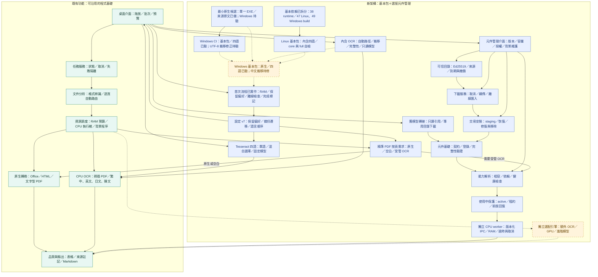

# MarkItDown-exe｜Windows 文件轉 Markdown

把 **Word、Excel、PowerPoint、HTML、文字與 PDF** 轉成可閱讀、可查核的 Markdown。以 Microsoft MarkItDown 為基礎，加入桌面操作、自動 PDF 分析、OCR、表格處理及 RAM 資源管理。

> **開發中**：已有 Linux 核心與桌面原型驗證。Windows 安裝包與 GPU 尚未實機驗收；目前沒有已驗證的 Windows 正式版下載。

| 版本／進度 | 狀態 |
| --- | --- |
| 程式原始碼版本 | **0.14.0**，新增 Windows 基本包自動建置／驗證 CI，Windows 原生建置及四語自檢已通過，中文搬移修正待驗；[查看每次更新與版本差異](CHANGELOG.md) |
| 架構指引 | **0.4**：基本安裝包＋選配元件管理 |
| 既有開發基線 | **19/25**；已完成範圍以 Linux 代表性證據為主 |
| 新架構導入 | **C01–C12：7/12**，C01／C02／C05／C06／C07／C08／C10 驗收完成；C03 四語／原生來源／Linux 內含整包三項、C04 兩項、C09 三項子檢核完成，完整項仍待基本包 |
| 功能測試基線 | **551 通過、1 項 ONNX 繁體品質預期失敗** |

## 模組架構封面

綠色為可沿用核心與桌面原型，藍色為 C01／C02／C05／C06／C07／C08／C10 已驗收的基礎服務，黃色為待實作項目。舊模型管理已接入桌面；C08 已接上背景元件管理，C07 提供真正 CPU 工作程序；C10 已接逐頁需求、文件租約與提交重驗；C04 已驗基本依賴與 Linux frozen 核心自檢，完整原生包仍保留虛線；C03 已加入四語模型／選擇與本機辨識，基本包新增內含四語與預設解析，Linux frozen 完整 OCR 已驗；Windows 2022 CI 已真正建置並通過四語健康及掃描自檢，中文搬移仍待 UTF-8 修正版驗證；乾淨機／完整 Windows 與 GPU 另驗。

[架構圖版本紀錄：舊版核心／第四節完整模組圖／對話簡圖／首頁比較圖](docs/architecture/README.md)



| 模組 | 中文責任說明 | 實作範圍 |
| --- | --- | --- |
| 桌面與應用服務 | 清單、批次、取消、預覽、任務生命週期 | 已有原型，待 Windows 驗收 |
| 核心與自動分析 | 任務契約、格式判斷、原生／掃描／空白頁路由 | 可沿用 |
| 資源與背景工作 | RAM 軟預算、系統保留量、低優先權、spawn 程序 | Linux 已測，實機負載待擴充 |
| 格式、OCR 與表格 | MarkItDown、Tesseract、合併格、稀疏表格與續表提示 | 有代表性驗收，非任意版面保證 |
| 品質與輸出 | 原文差異、頁面來源、輸出保護、Markdown／HTML 表格 | 可沿用 |
| 能力解析 | 重新核對元件相容性、依賴、實檔及可信健康探針 | C01 已驗收；C07／C10 在 OCR 頁重新驗證、固定版本與能力，原生／空白頁不要求 OCR 元件 |
| 設定與遷移 | v1–v6 讀取、v7 語言／偏好、原文備份及未來設定保護 | C02 基礎沿用；C03 新增語言順序，舊預設／路徑保留 |
| 四語模型與選擇 | 固定繁中／英／日／韓模型、明確語言與混合解碼 | C03 子檢核 138/138＋本機 10 項，完整 Windows 原生包待驗 |
| 最小原生來源建置 | 四項固定原始碼、靜態連結、runtime 原文與來源 receipt | C03 第二項：86/86＋真實來源 8 項；單一 Windows x64 EXE 無第三方 DLL 靜態相依，未執行 Windows |
| 內含四語與自動路徑 | 離線驗固定模型／引擎、搬移後解析、只讀模型管理與真正完整自檢 | C03 第三項：185/185＋Linux frozen 12 項、source Qt 3 項；Windows 僅資料包靜態 |
| 首次精靈 | 基本引擎檢查、RAM 建議與完成紀錄 | C09 流程／RAM 子檢核完成；基本包自帶 OCR 待 C03／C04，C09 全項未關閉 |
| 元件與更新服務 | 描述、登錄、下載、驗證、修復、移除及回復 | C01／C02 沿用，C05 下載、C06 安裝維護 API 完成；C08 背景管理完成；正式目錄與 Windows 仍待後續 |
| 基本版依賴 profile | 執行／建置閉包、平台 marker、原版 hash 與既有授權引用 | 依賴子檢核沿用；基本 frozen／自檢 86/86＋獨立程式 7 項／公開 PDF 5 項，完整 native／Windows 待驗 |
| 選配工作程序 | CPU／GPU 元件各自打包相依環境，避免改動核心 runtime | C07 實際 Linux CPU 元件通過；C08 管理、C10 文件路由已接；GPU 仍待實機 |

## 使用者能得到什麼

- 桌面拖放與批次轉換，顯示處理進度、取消及 Markdown 預覽。
- 精準 PDF 自動選擇原生解析或 OCR，保留頁碼、表格與品質提醒。
- RAM 自動／手動預算、系統保留量與 CPU 執行緒設定，降低與其他工作競爭；屬軟性預算。
- 模型版本與完整性驗證、離線手冊及第三方授權清單。

**新版發行目標**：基本包內含 Python、必要依賴、Windows Tesseract 與繁中／英／日／韓模型，安裝後離線可用；額外語言、ONNX／GPU 與進階模型由程式內按需管理。C07 已證明 Linux CPU 選配可在沒有 OCR 套件的控制端運作；完整開發包仍含 ONNX，C04 已完成 Python 依賴拆分與 Linux frozen 核心／自檢，基本環境仍因 Magika 保留 ONNX Runtime；完整自檢會指出缺少原生 OCR。最小 Windows 原生候選與四語 payload 已靜態組裝；Linux 基本包已內含引擎／四語與完整自檢，Windows 原生建置／執行及各 profile 完整驗收仍待完成。

預設仍是 Tesseract。ONNX OCR 為實驗性選配，繁體樣本有已知漏字／字形問題；GPU 偵測不等於可用，也不保證提高準確度。表格與閱讀順序有驗收範圍，圖表、公式及任意混排仍需後續擴充。

## 規劃、進度與版本紀錄

- [完整產品與模組化架構 v0.4](docs/architecture-guide.md)
- [每次更新與版本差異](CHANGELOG.md)
- [開發紀錄](docs/development-records/README.md)
- [開發進度與驗證範圍](docs/development-status.md)
- [互動進度頁：里程碑／模組／元件導入](docs/progress.html)（下載後可離線開啟）
- [基本包與選配元件決策](docs/decisions/0002-base-and-optional-components.md)
- [Windows 基本包自動建置／驗證 CI](docs/windows-base-ci.md)
- [C03 內含四語基本包、自動路徑與離線自檢](docs/bundled-base.md)
- [C03 最小 Windows 候選、離線建置與來源準備](docs/minimal-native-build.md)
- [C03 Windows 原生來源、DLL 與授權門檻](docs/windows-native-intake.md)
- [C03 四語模型、語言選擇與驗收範圍](docs/four-language-ocr.md)
- [C04 基本版依賴拆分與驗收範圍](docs/packaging-profiles.md)
- [C10 自動分析與受管元件協作](docs/managed-conversion.md)
- [C09 首次流程與 RAM 子檢核（完整項仍待基本包）](docs/onboarding.md)
- [C08 元件管理介面與操作範圍](docs/component-management.md)
- [C07 獨立 CPU 選配 worker 與協定](docs/component-workers.md)
- [C05 可信目錄與可恢復下載](docs/component-downloads.md)／[C06 交易安裝與元件維護](docs/component-lifecycle.md)
- [Windows 安裝包來源、自動驗收與實機待辦](docs/windows-acceptance.md)

## 功能與驗收文件

- [使用說明](src/desktop_app/data/user-guide.md)
- [C01 元件契約、登錄與能力解析](docs/components.md)／[C02 舊模型轉接與設定遷移](docs/component-migration.md)
- [精準 PDF 與 OCR](docs/precise-pdf.md)
- [PDF 合併儲存格](docs/merged-tables.md)／[跨頁候選關聯](docs/table-continuation.md)／[無框線與稀疏表格](docs/borderless-tables.md)
- [版面與表格驗收矩陣](docs/layout-acceptance.md)
- [裝置診斷與 CPU 執行緒](docs/devices.md)
- [ONNX、候選 CUDA 與品質限制](docs/onnx-ocr.md)／[雙引擎核對](docs/crosscheck.md)
- [第三方授權清單](src/desktop_app/data/third-party.md)／[授權檢核證據](docs/license-inventory.md)
- [依賴鎖定與建置方式](docs/packaging.md)

<details>
<summary>開發者：本機驗證、啟動與進度頁更新</summary>

## 本機開發驗證

需求 Python 3.11+ 與 psutil。專案根目錄執行：

```bash
python -m pip install -e .
python -m unittest discover -s tests -v
markitdown-desktop input.txt output.md --ram-budget-mib 1024 --reserve-mib 2048
```

若已提供 psutil 但無法存取套件來源，Linux 可直接驗證：

```bash
PYTHONPATH=src python -m unittest discover -s tests -v
PYTHONPATH=src python -m desktop_app.cli input.txt output.md
```

完整開發依賴與桌面啟動（專案根目錄）：

```bash
python -m pip install './vendor/markitdown[docx,pptx,xlsx,pdf]' '.[desktop,precise,onnx,test-formats]'
python -m desktop_app.desktop
python -m unittest discover -s tests -v
```

Linux 無桌面時以 `QT_QPA_PLATFORM=offscreen` 執行測試。未安裝 GUI／格式依賴時相關測試會明確跳過，不代表整合通過。CLI 可加 `--settings preferences.json` 載入版本化 RAM 設定，命令列參數優先。

CLI 可加 `--quality precise`（預設）或 `--quality fast`。掃描 OCR 另需本機 Tesseract 與模型，詳見 OCR 文件。

轉換使用獨立 spawn 程序、低優先權與 RAM 回壓；PDF 精準模式在頁面之間可暫停，Office／單頁解析及 OCR 原生步驟仍不能即時釋放記憶體。RAM 是軟性預算，不保證瞬時上限。輸出須支援同磁碟硬連結（例如 NTFS），不支援時明確失敗。

已有 Linux／Windows Python 3.12 雜湊鎖定檔，乾淨 Linux 安裝與測試已驗證；Windows 安裝、建置與完整安裝包待驗證。58 個 Windows 鎖定套件的授權清單及離線手冊已隨包驗證；最終 Windows 原生二進位／Qt 發佈義務仍需在建置後審核。

## 更新進度頁

以 `docs/progress.json` 為唯一視覺進度資料來源，更新實際完成項目與驗證證據後執行：

```bash
python scripts/build_progress.py
```

產生的 HTML 不使用外部資源。里程碑進度條採等權檢核，並非工期百分比；模組卡片可切換篩選。可選用 `scripts/check_progress_browser.py` 驗證瀏覽器互動，需要另外提供 Playwright 與 Chromium。

</details>
