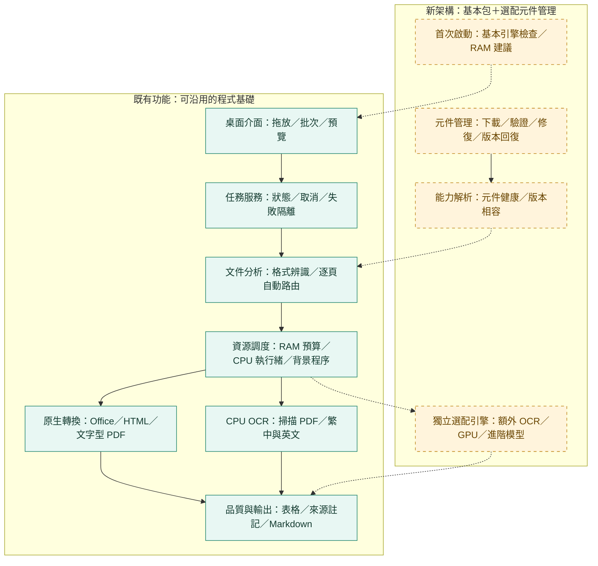

# MarkItDown-exe｜Windows 文件轉 Markdown

把 **Word、Excel、PowerPoint、HTML、文字與 PDF** 轉成可閱讀、可查核的 Markdown。以 Microsoft MarkItDown 為基礎，加入桌面操作、自動 PDF 分析、OCR、表格處理及 RAM 資源管理。

> **開發中**：已有 Linux 核心與桌面原型驗證。Windows 安裝包與 GPU 尚未實機驗收；目前沒有已驗證的 Windows 正式版下載。

| 版本／進度 | 狀態 |
| --- | --- |
| 程式原始碼版本 | **0.1.1**，維護更新；[查看每次更新與版本差異](CHANGELOG.md) |
| 架構指引 | **0.4**：基本安裝包＋選配元件管理 |
| 既有開發基線 | **19/25**；已完成範圍以 Linux 代表性證據為主 |
| 新架構導入 | **C01–C12：0/12**，待實作與驗收 |
| 功能測試基線 | **152 通過、1 項 ONNX 繁體品質預期失敗** |

## 模組架構封面

實線區塊為可沿用的核心與桌面原型；虛線連接的黃色區塊為新增導入規劃。Windows／GPU 的可用性仍須各自驗證。



| 模組 | 中文責任說明 | 實作範圍 |
| --- | --- | --- |
| 桌面與應用服務 | 清單、批次、取消、預覽、任務生命週期 | 已有原型，待 Windows 驗收 |
| 核心與自動分析 | 任務契約、格式判斷、原生／掃描／空白頁路由 | 可沿用 |
| 資源與背景工作 | RAM 軟預算、系統保留量、低優先權、spawn 程序 | Linux 已測，實機負載待擴充 |
| 格式、OCR 與表格 | MarkItDown、Tesseract、合併格、稀疏表格與續表提示 | 有代表性驗收，非任意版面保證 |
| 品質與輸出 | 原文差異、頁面來源、輸出保護、Markdown／HTML 表格 | 可沿用 |
| 首次精靈與能力解析 | 檢查基本元件、自動資源建議、判斷目前能使用哪些功能 | 待新增 |
| 元件與更新服務 | 可恢復下載、交易安裝、健康檢查、修復、移除及回復 | 待新增；現有模型管理可轉接 |
| 選配工作程序 | CPU／GPU 元件各自打包相依環境，避免改動核心 runtime | 待新增；GPU 候選路由尚未實機通過 |

## 使用者能得到什麼

- 桌面拖放與批次轉換，顯示處理進度、取消及 Markdown 預覽。
- 精準 PDF 自動選擇原生解析或 OCR，保留頁碼、表格與品質提醒。
- RAM 自動／手動預算、系統保留量與 CPU 執行緒設定，降低與其他工作競爭；屬軟性預算。
- 模型版本與完整性驗證、離線手冊及第三方授權清單。

**新版發行目標**：基本包內含 Python、必要依賴、Windows Tesseract 與繁中／英文模型，安裝後離線可用；額外語言、ONNX／GPU 與進階模型由程式內按需管理。現有開發包仍含 ONNX，基本 Tesseract native 與選配拆包尚未完成。

預設仍是 Tesseract。ONNX OCR 為實驗性選配，繁體樣本有已知漏字／字形問題；GPU 偵測不等於可用，也不保證提高準確度。表格與閱讀順序有驗收範圍，圖表、公式及任意混排仍需後續擴充。

## 規劃、進度與版本紀錄

- [完整產品與模組化架構 v0.4](docs/architecture-guide.md)
- [每次更新與版本差異](CHANGELOG.md)
- [開發進度與驗證範圍](docs/development-status.md)
- [互動進度頁：里程碑／模組／元件導入](docs/progress.html)（下載後可離線開啟）
- [基本包與選配元件決策](docs/decisions/0002-base-and-optional-components.md)
- [Windows 安裝包來源、自動驗收與實機待辦](docs/windows-acceptance.md)

## 功能與驗收文件

- [使用說明](src/desktop_app/data/user-guide.md)
- [精準 PDF 與 OCR](docs/precise-pdf.md)
- [PDF 合併儲存格](docs/merged-tables.md)／[跨頁候選關聯](docs/table-continuation.md)／[無框線與稀疏表格](docs/borderless-tables.md)
- [版面與表格驗收矩陣](docs/layout-acceptance.md)
- [裝置診斷與 CPU 執行緒](docs/devices.md)
- [ONNX、候選 CUDA 與品質限制](docs/onnx-ocr.md)／[雙引擎核對](docs/crosscheck.md)
- [第三方授權清單](src/desktop_app/data/third-party.md)／[授權檢核證據](docs/license-inventory.md)
- [依賴鎖定與建置方式](docs/packaging.md)

<details>
<summary>開發者：本機驗證、啟動與進度頁更新</summary>

## 本機開發驗證

需求 Python 3.11+ 與 psutil。專案根目錄執行：

```bash
python -m pip install -e .
python -m unittest discover -s tests -v
markitdown-desktop input.txt output.md --ram-budget-mib 1024 --reserve-mib 2048
```

若已提供 psutil 但無法存取套件來源，Linux 可直接驗證：

```bash
PYTHONPATH=src python -m unittest discover -s tests -v
PYTHONPATH=src python -m desktop_app.cli input.txt output.md
```

完整開發依賴與桌面啟動（專案根目錄）：

```bash
python -m pip install './vendor/markitdown[docx,pptx,xlsx,pdf]' '.[desktop,precise,onnx,test-formats]'
python -m desktop_app.desktop
python -m unittest discover -s tests -v
```

Linux 無桌面時以 `QT_QPA_PLATFORM=offscreen` 執行測試。未安裝 GUI／格式依賴時相關測試會明確跳過，不代表整合通過。CLI 可加 `--settings preferences.json` 載入版本化 RAM 設定，命令列參數優先。

CLI 可加 `--quality precise`（預設）或 `--quality fast`。掃描 OCR 另需本機 Tesseract 與模型，詳見 OCR 文件。

轉換使用獨立 spawn 程序、低優先權與 RAM 回壓；PDF 精準模式在頁面之間可暫停，Office／單頁解析及 OCR 原生步驟仍不能即時釋放記憶體。RAM 是軟性預算，不保證瞬時上限。輸出須支援同磁碟硬連結（例如 NTFS），不支援時明確失敗。

已有 Linux／Windows Python 3.12 雜湊鎖定檔，乾淨 Linux 安裝與測試已驗證；Windows 安裝、建置與完整安裝包待驗證。58 個 Windows 鎖定套件的授權清單及離線手冊已隨包驗證；最終 Windows 原生二進位／Qt 發佈義務仍需在建置後審核。

## 更新進度頁

以 `docs/progress.json` 為唯一視覺進度資料來源，更新實際完成項目與驗證證據後執行：

```bash
python scripts/build_progress.py
```

產生的 HTML 不使用外部資源。里程碑進度條採等權檢核，並非工期百分比；模組卡片可切換篩選。可選用 `scripts/check_progress_browser.py` 驗證瀏覽器互動，需要另外提供 Playwright 與 Chromium。

</details>
