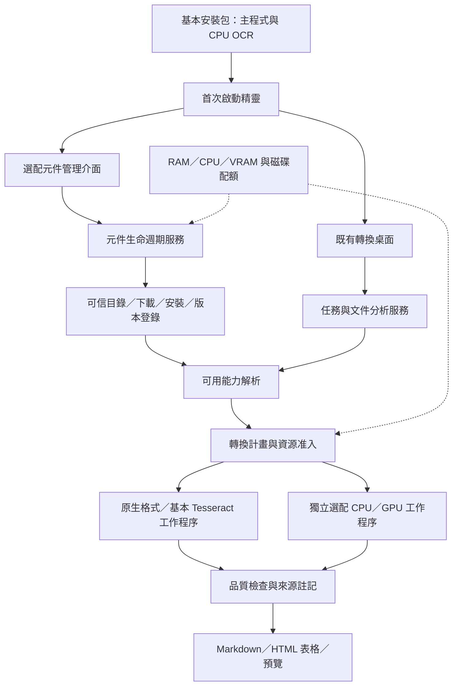

# Windows 文件轉換應用程式：產品與模組化架構指引

版本 **0.4**，2026-11-05。採用已確認的「**基本安裝包＋選配元件管理**」，取代 0.3 版發行與元件管理規劃。這是後續編寫、改寫與更新的架構依據；規劃不代表已實作。實際證據見 [開發狀態](development-status.md)、[驗證記錄](validation-results.json) 與 [視覺化進度](progress.html)。

舊版核心、新版指定對話原圖、第四節完整模組圖與責任表及首頁比較圖，另存於 [架構圖版本紀錄](architecture/README.md)，後續更新保留既有快照。

## 一、產品方向與版本邊界

以 Microsoft MarkItDown 原始碼為基礎，提供 Windows 桌面應用程式。主程式內含 Python 與必要依賴，使用者以安裝精靈完成安裝，無須自行安裝 Python、執行 pip、掛載 MCP 或管理命令列環境。第一目標為 Windows 11 x64；Windows 10 相容性必須另以實機證據確認。

產品由「可獨立離線使用的 CPU 基本版」與「依需求安裝的選配功能」組成。首次啟動精靈與元件管理位於既有桌面程式內；每次開啟直接進入轉換介面，不另建帳號、常駐下載服務或獨立大型啟動器。

一般轉換在本機完成。基本版維持 Tesseract 為 OCR 預設；ONNX OCR 仍是實驗性選配，不能因安裝方式改變而視為繁體品質已通過。相同模型改用 GPU 也不保證提高準確度。

第一版支援 UTF-8 文字、HTML、DOCX、XLSX、PPTX、原生與掃描 PDF、批次、拖放、進度、取消、預覽與輸出管理。圖片資產、複雜公式、任意版面深度模型、音訊及外部 AI 服務分期處理。Markdown 以內容完整、閱讀順序、可追溯結構為目標，不能承諾完整重現原始版面。

## 二、基本安裝包與選配元件範圍

以下為**目標拆分**；現有 PyInstaller 包尚未完成此拆分。

| 層級／元件 | 目標提供內容 | 安裝與使用原則 | 現況差距 |
| --- | --- | --- | --- |
| 基本主程式 | Qt 介面、內含 Python、MarkItDown、本機格式解析、PDF 原生分析與表格、批次及資源管理 | 隨 Setup 安裝，完成後可離線運作 | 核心可沿用；Windows 原生建置待執行 |
| 基本 CPU OCR | 固定版 Tesseract Windows 執行檔、必要 DLL、繁中／英文模型及原授權 | 隨基本安裝包提供並自動設定；一般使用者不用另找引擎 | CPU 流程、模型下載已存在；Windows 原生檔與 DLL／授權整合待完成 |
| 額外語言模型 | 其他已驗證 Tesseract 語言模型 | 由元件管理按需安裝，可離線重用 | 現在僅有繁中／英文固定模型管理 |
| ONNX CPU OCR | RapidOCR、辨識模型及經鎖定的執行環境 | 獨立選配工作程序；明示實驗性品質，不自動取代 Tesseract | 現在隨開發包綁定，尚未獨立拆包 |
| NVIDIA GPU OCR | 已驗證的 GPU 工作程序、模型及相容 CUDA 使用者態依賴 | 偵測相容性、顯示下載／磁碟需求，使用者選用後安裝；實機通過才開放 | 目前只有候選路由與模擬測試，桌面 GPU 未開放 |
| 進階版面／表格模型 | 針對特定文件的額外分析能力 | 先有合法來源、品質對照及資源量測，再列入目錄 | 尚未選定與整合 |
| 外部 AI／音訊 | 明確選配的後續擴充 | 需另訂資料流、費用與依賴規則 | 不納入基本版完成條件 |

**必要依賴不能只按名稱刪除。** 現有 MarkItDown 的 Magika 格式辨識也依賴 ONNX Runtime。把「ONNX OCR」改為選配，不代表主程式可以移除所有 ONNX Runtime。先建立相依閉包與基本／選配鎖定檔，再實測體積；不得先承諾基本包很小或某個下載容量。

現有繁中／英文 Tesseract 模型約 6.4 MB，不含 Windows 引擎與 DLL。GPU 及進階模型不強迫隨基本包下載；顯卡驅動仍採官方管道，程式偵測、說明並引導，不承諾靜默安裝驅動、免重新開機或略過 Windows 安全提示。

## 三、使用流程與操作設定

基本安裝：執行 Setup → 安裝內含執行環境與基本 OCR → 首次檢查 → 自動規劃 RAM → 進入轉換。離線時基本流程也須成功；首次啟動不得因查不到更新而阻擋轉換。

首次精靈顯示基本元件是否可用、RAM 建議與選配功能。保留預設即可使用；勾選某元件並開始安裝即授權該次下載／驗證，不逐檔重問。既有使用者更新後只補做未完成的檢查，不清除已儲存設定。

一般轉換：匯入文件 → 選擇品質／資源／輸出 → 自動分析 → 依已就緒能力建立計畫 → 背景轉換 → 品質檢查 → 預覽／儲存。系統不得默默為一份文件安裝大型選配功能。

| 畫面／設定 | 目標行為 |
| --- | --- |
| 主視窗 | 保留拖放、批次、進度、取消、預覽與輸出資料夾 |
| 品質 | 快速、精準；精準模式自動決定逐頁解析與 OCR，進階覆寫另保留 |
| 裝置 | 自動、CPU、已通過驗證的 GPU；顯示實際後端及回退原因 |
| RAM／CPU | 自動或手動 RAM 預算、系統保留量、CPU 執行緒上限 |
| GPU | 顯示記憶體預算與相容性，未驗證能力不顯示成可用 |
| 元件管理 | 已安裝／可更新／待安裝／損毀／不相容／使用中，版本、授權、大小、安裝位置、修復與移除 |
| 更新 | 第一階段手動檢查／通知並選擇安裝；背景自動更新後續另做，不於轉換中替換引擎 |
| 離線 | 使用已驗證元件；可匯入可信離線元件包，遵守相同簽章與完整性規則 |

下載顯示真實已收位元組；已知總長時才顯示百分比。安裝、驗證、解壓及健康檢查分別顯示階段，不捏造統一百分比。故障顯示可操作原因與重試，單一選配元件失敗不影響可用的基本轉換。

## 四、模組化架構與責任

依賴方向為 UI → 應用服務 → 核心契約／能力解析 → 引擎轉接器；視窗不直接下載、執行安裝指令或更換 runtime。文件分析決定需要什麼，能力解析決定有哪些，資源調度決定何時與以多大負載執行。



| 模組 | 責任與界線 | 既有基礎／處理方式 |
| --- | --- | --- |
| desktop／ui | 轉換、預覽與資源設定 | 沿用 desktop.py；只增加精靈及元件介面入口 |
| onboarding | 首次檢查、引擎就緒、初始設定與完成紀錄 | 新增；不常駐、不強制連網 |
| application | 任務、批次、狀態、取消與失敗隔離 | 沿用 Runner；增加元件版本固定與能力解析 |
| core | 任務、結果、錯誤、能力與元件契約 | 延伸 core.py，保留既有 Request 相容性 |
| planning／analysis | 格式、逐頁路由及必要處理判斷 | 沿用 planning.py、pdf_pipeline.py；支援能力不足的明確結果 |
| capabilities | 格式需求、元件健康與相容性解析 | 新增；讀取實測健康紀錄，不以已下載代替可用 |
| components | 安裝／修復／移除／版本與使用中鎖定的服務入口 | 新增；內部分開 catalog、registry、download、installer、locks |
| component_workers | 選配引擎的程序協定、逾時、取消與結果轉接 | 新增；各自打包 runtime，不把任意 Python 套件注入主程式 |
| converters | MarkItDown 與原生格式解析 | 沿用 conversion.py 及 vendor 轉接，不重寫所有格式 |
| inference／models | OCR、模型與裝置後端 | 既有 Tesseract／ONNX 分別做 adapter，模型管理逐步接入 components |
| resources | RAM／CPU／VRAM 准入、回壓、暫停／恢復 | 沿用 resources.py；加入下載、解壓、安裝及磁碟預算 |
| workers | 任務程序隔離、資源控制與清理 | 沿用 workers.py；增加與獨立元件 worker 的橋接 |
| quality／exporters | 差異、結構、來源註記與輸出保護 | 沿用既有品質、表格、輸出流程，不因拆包降低判準 |
| updates | 主程式／元件相容性、更新通知、回復 | 新增；主程式由安裝器更新，元件走受控生命週期 |
| settings／infrastructure | 設定、索引、日誌、檔案、快取 | C02 已完成 v1–v5→v6 與備份；不搬移未知檔案 |
| packaging／diagnostics | 發行 profile、原生元件、授權、安裝與自我檢查 | 沿用 Inno／PyInstaller／diagnostics，改成按 profile 驗收 |

新增是責任與介面的拆分，不等於每列都要重做一套框架。統一文件結構按需求逐步加入段落、標題、表格、圖片、公式與來源；現有 Markdown 相容結果繼續可用。選配元件先限定專案維護的固定功能，不建立第三方外掛商店。

## 五、元件契約、儲存與隔離

實作更新（2026-11-06）：程式 0.4.0 完成 [C01](components.md)、[C02](component-migration.md)、[C05](component-downloads.md)與 [C06 交易安裝／維護](component-lifecycle.md)。元件服務 API 已驗收；實際選配 worker、完整元件 GUI、自動路由及 Windows／GPU 尚待後續，不把服務測試當成已可發行的 Windows 產品。

元件目錄至少記錄：ID、種類、版本、來源／授權、包檔大小與解壓上限、SHA-256、平台／架構、依賴、app／worker 協定版本範圍、RAM／VRAM／磁碟需求、提供的能力、健康檢查方式及受信任簽章資訊。資源數值屬預估，後續以實測校準。

登錄紀錄另保存下載、驗證、安裝、健康檢查、啟用與使用中的實際狀態。`ready` 必須同時滿足完整性、相容性與健康檢查，不能只看目錄存在或 provider 名稱。

既有 models.py 僅處理固定三個檔案，且單檔限制 16 MiB；這些限制保留給舊模型 adapter。新的元件下載／驗證應採可信清單宣告的包檔與解壓上限，不直接把舊 helper 套在較大的引擎或 GPU 元件包。

選配 CPU／GPU 引擎使用自己的打包工作程序與相依版本，透過版本化控制協定傳遞本機輸入／輸出位置、任務 ID、資源政策、進度、取消及錯誤。以參數陣列啟動，不經 shell 拼接；控制訊息限長，完整文件結果放受管理的輸出檔，不無界塞入 IPC。

CUDA／CPU ONNX runtime 不混裝於主程式同一 Python 環境。Magika 必要 CPU runtime 維持在核心相依閉包；GPU 功能由獨立 worker 驗證其實際 provider 與推論結果。設定相同輸入、模型與版本再做品質／效能比較。

目錄目標如下（規劃，尚未建立所有程式模組）：

```text
src/desktop_app/
  desktop.py, application.py, core.py, resources.py, workers.py
  onboarding/             首次啟動服務與介面
  components/             contracts、catalog、registry、download、installer、locks
  capabilities.py         已就緒能力與處理需求
  component_workers/      外部元件程序轉接與協定
  updates/                主程式與元件更新協調
  models.py, onnx_ocr.py   相容 adapter，分期遷移
packaging/
  profiles/               base、onnx-cpu、cuda 等獨立鎖定與打包規格
  build-windows.ps1, windows-installer.iss, verify-windows-install.ps1
```

安裝目錄只放受管理的基本程式、基本 OCR 與授權。選配元件目標置於 Qt 使用者資料根目錄下 `components/<id>/<version>`，另分 registry、cache、staging、logs；輸出由使用者選擇。不可硬編碼假定帳號或變更使用者指定的外部引擎／模型目錄。

## 六、自動分析與品質規劃

精準模式繼續自動分析。Office 優先原生資料；PDF 逐頁判斷可用文字、亂碼、掃描／混合／空白、多欄、表格與必要 OCR。只有需要時安排昂貴模型，並受資源與重試上限控制。

| 情境 | 規劃行為 |
| --- | --- |
| 基本 CPU 能力足夠 | 直接建立轉換計畫；不用下載選配元件 |
| 基本必要元件損毀 | 顯示基本能力未就緒並提供修復；未受影響格式仍可用 |
| 缺少額外語言／進階模型 | 說明缺少的功能與所需容量，可安裝、選擇已支援方案或略過該文件；不得把不完整結果標成完整成功 |
| 選用 GPU 後不相容／不足 | 自動模式先經 RAM 准入再回退 CPU；明確指定 GPU 時報告失敗，不靜默改 CPU |
| 選配功能只提供較高成本改善 | 使用者先選用，模型與版本固定於該任務，不在處理中自動升級 |

保留合併格 HTML、稀疏表空格、各頁來源、續表候選提示與原有正反例。跨頁提示不代表自動合併長表；任意混排、掃描表格、圖表／公式與圖片資產仍需後續能力與驗收。雙引擎保留原文及差異，不自動修字或繁簡轉換。

品質報告記錄 app／元件／模型版本、實際裝置、回退原因與來源，測試通過、已知缺口與未驗證分開。未達繁體品質目標的 ONNX 不能替代基本預設。

## 七、RAM、CPU、GPU 與磁碟資源

保留自動／手動 RAM、系統保留量、低優先權、受限執行緒、順序派送、回壓與遲滯恢復。預算涵蓋主程式、程序樹、預覽、模型、下載緩衝、解壓與健康檢查；Windows 量測仍須實機校準。

下載採串流、限制緩衝與併發，不把整個包放 RAM。開始前同時檢查壓縮包、解壓、舊版回復及暫存所需磁碟；超量停止或延後，不刪使用者文件。安裝／健康檢查與轉換共用准入政策，預設避免同時形成峰值。

工作程序啟動前再檢查 RAM，載入 GPU 前檢查 VRAM；GPU 回退 CPU 重新准入。正在使用的版本保持鎖定，維護工作等待安全點或下次啟動。等待、下載重試與模型重試皆有上限，保留取消。

RAM 與 GPU arena 為軟性預算，不保證瞬間不超量或其他作業完全不卡頓。Windows Job Objects、模型負載校準與硬性資源限制另行原型驗證。磁碟快取有配額，僅清除可確認所有權且未使用的快取／暫存。

## 八、元件安裝、修復與更新生命週期

```text
缺少 → 下載中 → 完整性驗證 → 解壓／安裝 → 健康檢查 → 就緒 → 使用中
                         ↘ 失敗／不相容 → 保留可用舊版並提供重試
就緒舊版 → 安裝新版本於 staging → 驗證成功 → 原子啟用 → 舊版按保留政策回收
```

受控目錄使用可信來源目錄與簽章驗證；SHA-256 用於內容一致性，不能單獨證明來源。基本包內含信任根或經驗證離線清單；金鑰輪替、相容性與失效清單須版本化。TLS 保持驗證，不接受任意網路位址作為可執行元件來源。

下載支援取消、限次重試與斷點續傳；服務端須支援 Range，且 URL／ETag／版本匹配才續傳，否則重新下載。下載與離線匯入都做完整驗證、路徑逃逸／連結／解壓超量檢查，失敗不啟用。

安裝鎖防止並行修改；新版本使用獨立 staging，健康檢查成功才原子切換 active 指標。斷電／崩潰重啟後可辨識未完成事務並回復；不能刪改正在使用或來源不明的舊檔。支援版本協定的健康檢查，不執行目錄提供的任意 shell 指令。

元件移除顯示依賴與使用狀態，必要基本元件不提供單獨刪除；選配被任務使用時延後移除。一般解除安裝保留使用者設定、下載元件／模型與文件；完整清理另由使用者明確選擇，且只刪受管理資料。

主程式更新先採新的已驗證安裝包；元件更新由元件服務處理。先完成手動檢查／通知、失敗回復與離線重用，再評估背景自動更新。Windows 權限、安全提示、驅動與重新啟動不可承諾全程無互動。

## 九、既有成果沿用與調整清單

以下以提交 b5b706e 的實際證據為基準。

| 已有項目 | 可以沿用 | 新架構需要補的部分 |
| --- | --- | --- |
| 官方 MarkItDown 原始碼與雜湊 | 固定提交、vendor 及比較基線 | 按發行 profile 重新解析相依閉包 |
| 原生格式／PDF 精準流程 | 文字、Office、HTML、逐頁路由、表格與既有驗收 | 接入能力解析；格式本身不全面重寫 |
| Qt 桌面與批次 | 拖放、進度、取消、預覽、設定 | 新增首次精靈與元件管理頁 |
| Runner／workers／resources | spawn、隔離、軟預算、回壓、CPU 上限 | 納入元件維護與外部 worker 的准入與生命週期 |
| models.py／model_dialog.py | 固定 Tesseract 模型、下載、取消、驗證、受管移除 | 目前限三個檔案，須轉接通用登錄；尚無通用斷點續傳／交易式安裝 |
| ONNX／裝置診斷 | CPU 推論、模型雜湊、候選 CUDA／回退政策 | 從主包拆選配 worker；GPU 硬體驗收與繁體品質仍待完成 |
| Inno／PyInstaller／Windows 腳本 | 每位使用者安裝、manifest、安裝與解除安裝驗收來源 | 基本／選配 profile、基本 Tesseract native、依 profile 授權與自我檢查 |
| diagnostics.py | 離線自我檢查、中文路徑、spawn、PDF、授權 | 現在必測 ONNX；基本包改驗基本 Tesseract，選配才驗 ONNX／GPU |
| 設定 schema v5 | 舊設定與明確外部路徑 | v6 相容遷移、元件偏好與精靈完成紀錄，不擅自換後端 |
| 授權與手冊 | 58 套件、214 文件基線與離線說明 | 加入新 native／元件包來源與授權，重做最終 Windows 再散布檢核 |

現有證據：Python 153 項中 152 通過、1 項 ONNX 繁體品質預期失敗；版面／表格矩陣 63 項通過；Linux frozen 自我檢查 5 項通過；PowerShell Linux 工具測試 9 組。Windows、GPU、安裝包與乾淨機均未實際驗收，不能因規劃更新而改為通過。

## 十、相容遷移與發行策略

設定解析規則：使用者明確指定且有效的引擎／模型路徑優先，其次為就緒的受管基本元件；外部自備路徑只引用，不接管、覆寫或刪除。舊模型可驗證後登錄為既有來源，未確認所有權前不移動或刪除。

若明確指定的路徑失效，顯示原因與改用受管元件的選項，不靜默改換使用者選擇。

C02 已完成 v6 遷移讀取 v1–v5，保留品質、RAM／CPU／VRAM 與 OCR 後端。已保存精靈版本、元件偏好、更新頻道與選配下載意願；精靈與更新服務本體仍待開發；登錄中的安裝狀態獨立保存，不把設定檔當作健康證據。遷移前備份，失敗保留舊檔；舊版應拒絕不支援的新 schema，避免覆寫。

主程式回復須選擇相容的設定與登錄快照，不能直接讓舊程式讀取不支援的 v6；較新版資料保留以供後續恢復。元件回復也須重新驗證目前 app 與 worker 協定相容性。

先以 adapter 接通新介面，再切換讀取來源；每階段保留舊流程回歸，不一次搬動所有模組。舊開發包已含 ONNX，仍按舊 profile 描述；新版基本包不能沿用「ONNX 必定存在」的 import、UI、鎖定檔、license 及自我檢查假設。

基本 CPU 版可先發佈，GPU 通過後另開放；未完成的選配項不列為可安裝可用。第一個基本版也必須有離線基本 OCR，不得以未驗證的 ONNX 替代缺少的 Tesseract 原生整合。

## 十一、驗收與發佈門檻

| 領域 | 必須具備的證據 |
| --- | --- |
| 基本包 | 無外部 Python／pip／Tesseract 的乾淨 Windows；斷網安裝、首次開啟、原生格式與繁中／英文掃描轉換 |
| 選配生命週期 | 首裝、取消、限次重試、續傳與失效續傳、損毀、無權限、磁碟不足、安裝中斷、重啟恢復、版本不相容與離線匯入 |
| 相依與版本 | 核心 Magika 正常；選配 CPU／GPU runtime 不覆蓋主程式；使用中鎖定、更新回復、依賴移除限制 |
| 遷移與資料 | v1–v5 設定、外部自備引擎／模型不被接管、使用者檔案與輸出不被安裝／更新／解除安裝刪除 |
| 資源 | 下載／解壓／健康檢查和轉換競爭、低 RAM／磁碟、模型峰值、暫停／取消無死鎖，量測峰值與超量 |
| 品質 | 固定版本與原文樣本，維持既有欄列／閱讀順序／繁中判準；新模型以額外樣本比較，不能只檢查程序成功 |
| GPU | 支援卡／驅動／provider、真實模型推論、VRAM 峰值、不足與 OOM、CPU 重新准入、加速與品質對照 |
| 發佈 | Windows 原生建置、基本／選配 profile 的鎖定、來源、SBOM／授權、簽章、安裝／升級／修復／解除安裝與人工 UI 驗收 |

Linux 可先完成契約、元件事務、下載與協定測試；PowerShell Linux 解析與模擬 GPU 不能取代 Windows 或 GPU 實機。安裝後自我檢查依能力執行：基本包不強制要求選配 ONNX；選配必測各自真正載入／推論，不以略過當作通過。

## 十二、開發里程碑與接續順序

保留既有 0–5 階段及 **19/25** 檢核作為歷史開發基線；它不是新版完整產品完成率。新架構增加獨立的 **C01–C12 導入驗收**，目前 **4/12**：C01／C02／C05／C06 完成 Linux 驗收；C06 92 項含 C05 回歸，另有 11 次真實程序退出與恢復證據。C03／C04 Windows 原生與完整 profile 門檻保留，其餘仍待各自驗證。兩個分母不相加，不用撰寫規劃把功能標成完成。

| 原階段 | 既有基線 | 新架構接續工作 |
| --- | --- | --- |
| 0 規格與調查 | 3/4 | 本版規劃、相依閉包、元件與版本契約；Windows 可行性仍待驗 |
| 1 核心轉換 | 5/5（Linux 基線） | 能力解析、元件版本固定、舊契約相容 |
| 2 桌面 MVP | 4/5 | 元件管理、首次精靈、基本引擎自動就緒；Windows UI 實測 |
| 3 自動精準 | 5/5（代表性樣本） | 依已就緒元件自動路由、缺元件處理與原品質回歸 |
| 4 GPU／模型 | 1/3 | 通用元件事務、獨立後端、CPU／GPU profile 與實機壓力 |
| 5 發佈準備 | 1/3 | 基本與選配包、更新／修復／離線及重新授權檢核、乾淨 Windows |

| 次序 | 導入檢核 | 可驗收的完成條件 | 對應原階段 |
| --- | --- | --- | --- |
| A 基礎 | C01 元件／能力／版本契約與登錄（已完成） | Linux 43/43：相容性、狀態、依賴、能力解析與持久化，下載完成不等於 ready | 0、1、4 |
| A 基礎 | C02 舊模型 adapter 與設定遷移（已完成） | Linux 61/61：設定 v6／備份、登錄 schema 2、外部只讀、原下載／桌面／轉換回歸，未接管資料不移除 | 1、2、4 |
| B 基本包 | C03 Windows 基本 Tesseract 與雙語離線 OCR | 固定原生檔／DLL／模型／授權，無外部引擎可離線轉掃描 PDF | 0、3、5 |
| B 基本包 | C04 profile 鎖定、打包與自我檢查 | 核心相依閉包正確、基本包不依賴選配、各 profile 清單／授權與能力自檢 | 0、5 |
| C 元件服務 | C05 可信目錄與可恢復下載（已完成） | Linux 41/41＋HTTPS 6/6：簽章／來源、取消、限次重試、Range／ETag、離線匯入與損毀拒絕 | 4 |
| C 元件服務 | C06 交易安裝、鎖、修復與移除（已完成） | Linux 92/92：staging、原子啟用、真實程序退出恢復、版本回復、使用租約與快取配額；實際任務接線待 C07／C10 | 1、4、5 |
| C 元件服務 | C07 獨立選配 worker 協定 | 至少一個實際 CPU 選配 worker，可控逾時／取消／資源與版本，不改主 runtime | 1、4 |
| D 使用流程 | C08 元件管理介面 | 版本／容量／授權／健康狀態與維護動作可操作，失敗不阻塞基本功能 | 2 |
| D 使用流程 | C09 首次啟動與基本引擎自動設定 | 新裝離線可用、RAM 建議、略過選配與再啟動不重複設定；保留舊偏好 | 2 |
| D 使用流程 | C10 自動分析與可用能力協作 | 原品質回歸；缺元件有可選處理與批次隔離，不默默下載或降低品質 | 1、3 |
| E 實機驗收 | C11 Windows 完整生命週期 | 無 Python 乾淨機、離線、安裝／升級／修復／回復／移除、使用者資料及人工 UI 通過 | 0、2、5 |
| E GPU 加值 | C12 GPU 真實推論與資源／品質矩陣 | 實卡與相容依賴、VRAM／OOM／回退准入及負載、品質與效能比較 | 4、5 |

C01／C02／C05／C06 已完成。C03／C04 的完整門檻仍需 Windows 執行器；下一段接續 C07 實際 CPU worker 與協定，再按相依關係接入 C08–C10。取得 Windows 執行器後優先補基本 CPU 與 profile 證據。基本版交付需 C01–C11 的相應證據；GPU 功能另待 C12，不阻擋已通過的 CPU 基本版。

目前不承諾固定工期或包體積；先量測 Windows 原生整合、下載大小、模型負載與品質，再估算。變更契約／模型／資源策略需補相容與回歸證據。規劃、實作、驗證與發佈分別記錄；所有新增元件都要有來源、授權、固定版本與可重驗雜湊。
