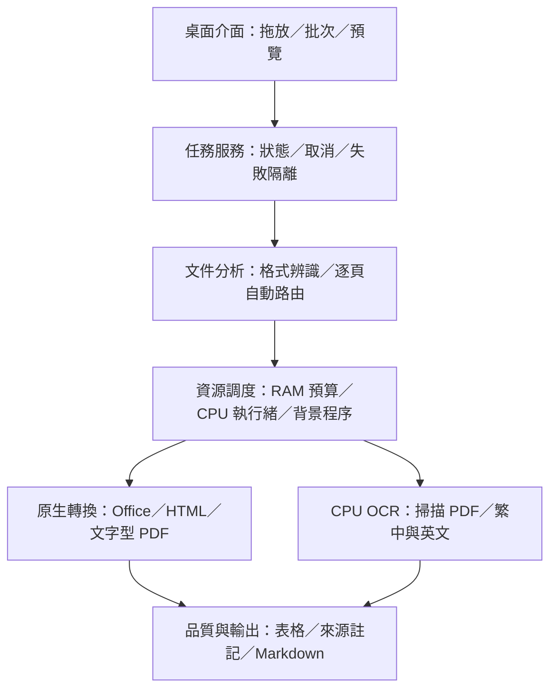

# 舊架構：既有轉換核心（回溯整理）

保存日期：2026-11-06（台北）。程式原始碼版本：0.1.1。

範圍對應架構指引 v0.3 的既有轉換核心。此圖由已提交首頁的 Existing 區塊抽出，方便單獨比較；它是本次回溯整理的圖，不宣稱先前已有這份獨立圖檔。

沿用重點：桌面與任務服務、文件自動分析、RAM／CPU 調度、原生格式與 CPU OCR、品質與輸出。

這張圖沒有新增首次精靈、通用元件管理、能力解析或獨立選配引擎；既有 OCR 與桌面證據主要限 Linux，Windows／GPU 未實機通過。

來源：[首頁既有區塊固定提交](https://github.com/ChouTa-chuan/MarkItDown-exe/blob/eaff81750d0c60f0798e2ce34c7b8c22b5dd913c/README.md)；[原 v0.3 架構指引](https://github.com/ChouTa-chuan/MarkItDown-exe/blob/b5b706e1063cfaf2705b1bcd88b95426469b5206/docs/architecture-guide.md)。

[返回架構紀錄索引](../README.md) · [目前完整架構指引](../../architecture-guide.md)
