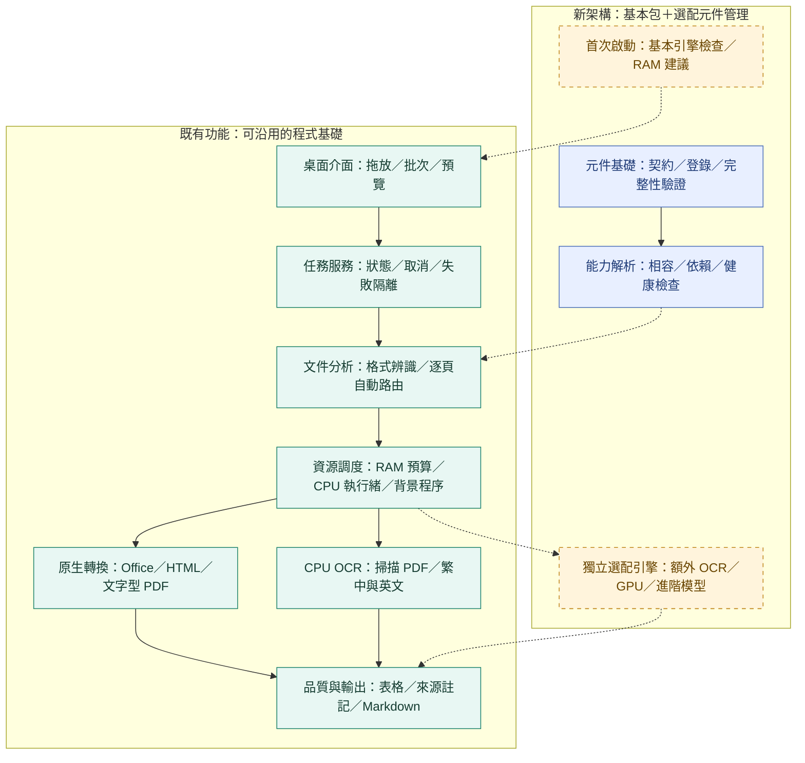

# 架構 v0.4：C01 元件基礎實作進度

保存：2026-11-06（台北）。程式 0.2.0，架構 0.4；此圖與本次首頁一併提交，描述 C01 完成後的狀態，不改寫先前快照。

綠色為既有核心，藍色為已通過 Linux 底層驗收的契約／登錄／能力解析，黃色為待實作項目。虛線為尚待接入桌面、分析與資源流程的部分；沒有宣稱下載、交易安裝、Windows 或 GPU 已完成。

新增導入 1/12，既有 19/25 另計；詳見 [C01 說明](../../components.md)與[版本索引](../README.md)。
