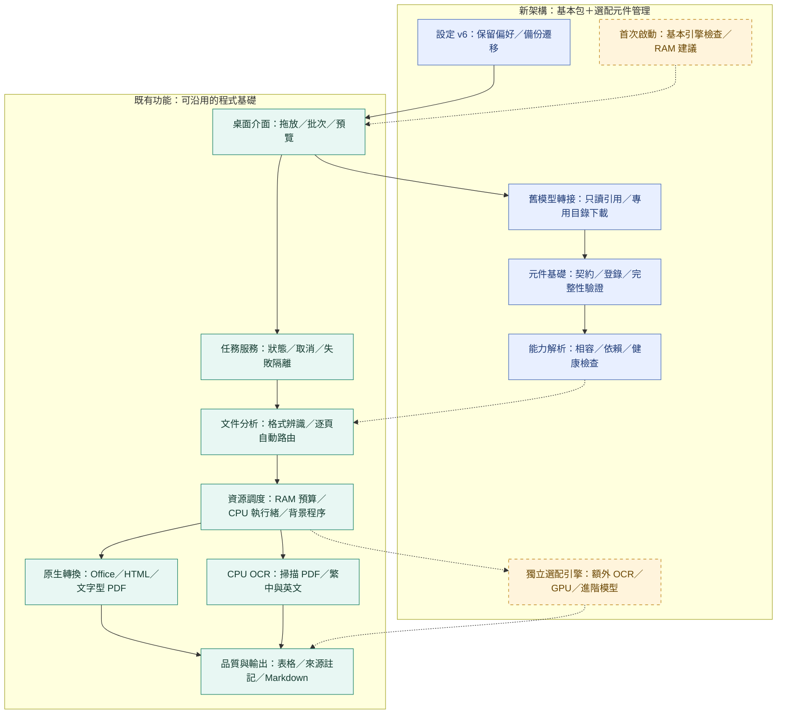

# 架構 v0.4：C02 舊模型與設定遷移

保存：2026-11-06（台北）。程式 0.2.1，架構 0.4；與本次首頁一併提交。綠色為既有核心，藍色為 C01／C02 已驗收範圍，黃色為待開發部分。舊模型管理與設定已接入桌面，能力解析自動路由的虛線仍待 C10。

新導入 2/12，既有 19/25 另計；Windows／GPU 未實機驗收，模型驗證不代表引擎 ready。見 [C02 說明](../../component-migration.md)與[架構圖索引](../README.md)。
