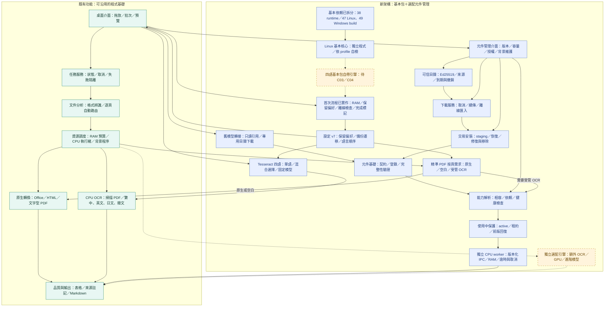

# 架構 v0.4：C03 四語模型與語言選擇

保存日期：**2026-11-08（台北）**。程式 **0.10.0**，架構 **0.4**；第十五份快照，前十四份保持固定。來源為本次首頁圖，與實作一併提交。

依使用者需求，基本包目標擴充為繁中／英文／日文／韓文；本輪完成 C03 本機四語 1/4 子檢核。完整 C03／C04／C09 未關閉，總數 **7/12**，既有 **19/25**。

新增 LANGUAGES 節點，設定 v7 保存有順序語言選擇，舊 v1–v6 原文及偏好保留；Tesseract 的 OCR 頁使用所選模型，原生頁不要求 OCR。四語混合不是自動語言分類；缺所選模型或日韓搭配未驗 ONNX 時明確失敗，不換後端。

138 項回歸、本機 Tesseract／CLI／Qt 10 項通過；四種單語與固定四頁混合原文符合，全專案 458 項為 457 通過、1 既有繁體品質預期失敗。合成樣本不代表一般準確率。模型資料約 10.6 MB，不含原生引擎或 RAM；Windows／GPU、原生 DLL、四語整包與正式發行仍待驗。

[四語指南](../../four-language-ocr.md) · [本輪紀錄](../../development-records/runs/c03-languages-2026-11-08/README.md) · [架構索引](../README.md)
