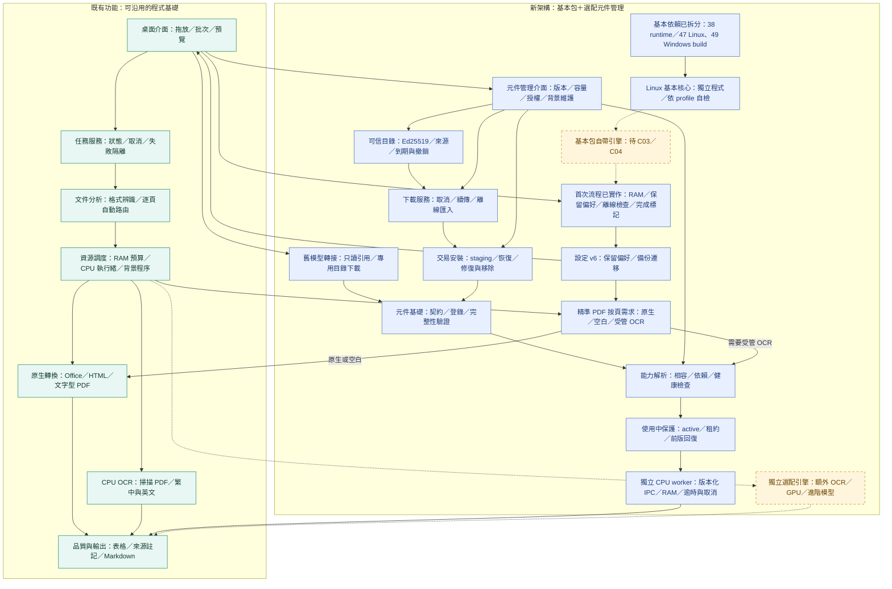

# 架構 v0.4：C04 基本核心打包與自我檢查

保存日期：**2026-11-08（台北）**。程式 **0.9.0**，架構 **0.4**；第十四份快照，前十三份保持固定。來源為本次首頁 Mermaid，與實作一併提交，沒有改寫舊圖。

C04 完成 2/4 子檢核：基本依賴拆分、Linux 基本 profile 的 PyInstaller／自檢。核心四項通過，完整自檢因缺 C03 原生 OCR 必須失敗；完整 C04／C09 未關閉，總數 **7/12**，既有 **19/25**。

藍色 PROFILEBUILD 是真正 Linux frozen 核心與內嵌能力／資產清單；與尚缺原生引擎的 FIRST 之間保留虛線。38 個 runtime 保留 Magika 所需 ONNX Runtime，沒有 RapidOCR OCR 模型；235 份資產有 hash，實際授權／binary 來源另存，不宣稱完成全部再散布／原生 OCR 審核。

86 項回歸、獨立程式 7 項及公開 PDF 5 項通過；全專案 440 項為 439 通過、1 既有繁體品質預期失敗。Windows／GPU、完整 profile、C03 與產品發行均未驗收。

[profile 指南](../../packaging-profiles.md) · [本輪紀錄](../../development-records/runs/c04-build-2026-11-08/README.md) · [架構索引](../README.md)
