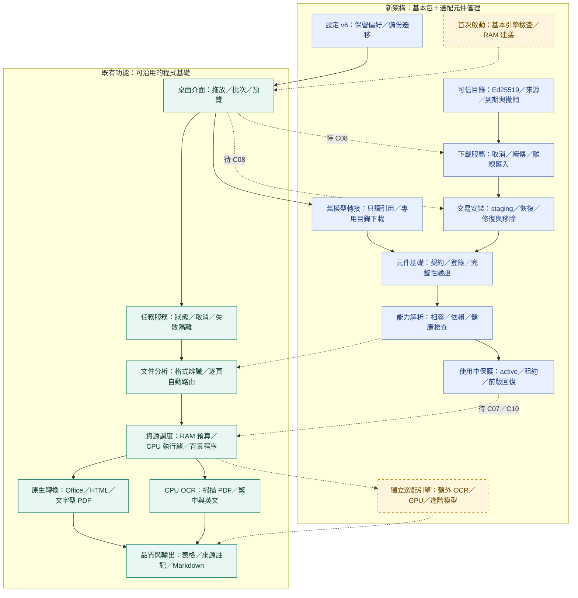

# 架構 v0.4：C06 交易安裝與元件維護

保存：2026-11-06（台北）。程式 0.4.0，架構指引 0.4；與本次首頁一併提交。藍色新增交易安裝、恢復及 active／租約／回復；虛線為實際 worker、GUI 與轉換路由尚待接線。C03／C04 Windows OCR 與完整 profile、Windows／GPU 實機門檻保留。

新導入 4/12（C01／C02／C05／C06），既有 19/25 另計；C06 證據為 Linux API、真實檔案／資料庫與子程序，不是 Windows 產品驗收。見 [C06 說明](../../component-lifecycle.md)與[圖版索引](../README.md)。
