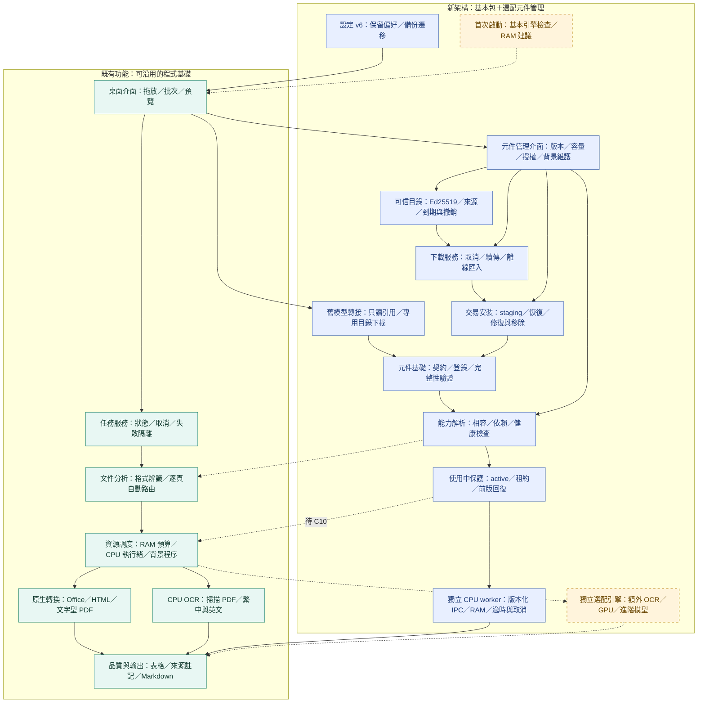

# 架構 v0.4：C08 背景元件管理介面

保存：2026-11-07（台北）。程式 0.6.0、架構 0.4，與本次首頁一併提交。藍色新增元件管理介面與下載／安裝／健康的實際連線；文件自動路由保留 C10 虛線。正式選配來源未發布，預設不內建測試信任根。

新導入 6/12（C01／C02／C05／C06／C07／C08），既有 19/25。C08 152 項含回歸，另有真實 Qt／frozen CPU 9 項；控制端空 PATH、原生取消與程序退出、維護後基本文字轉換均通過。這是 Linux 自動化證據，Windows／GPU、C09 首次精靈、C10 文件路由及正式發行仍待後續。

[元件介面設計與驗收](../../component-management.md) · [快照索引](../README.md)
