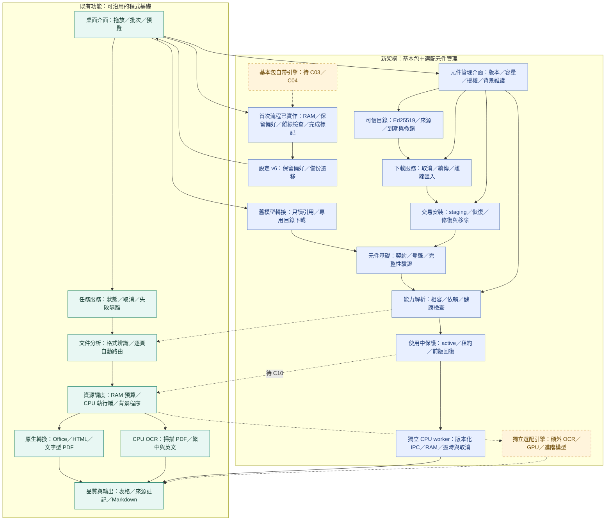

# 架構 v0.4：C09 首次流程／RAM 子檢核

保存：2026-11-07（台北）。程式 0.7.0、架構 0.4。藍色為已驗收的首次流程，黃色為基本包自帶引擎仍待 C03／C04。C09 三個子檢核通過，整項未關閉；已驗收維持 6/12，既有 19/25。

94 項流程回歸及 9 項真實 Qt／系統 Tesseract 流程通過；測試預備模型不是安裝包內含引擎的證據。Windows／GPU、正式來源、C09 完整基本包及 C10 路由仍待後續。

[首次流程設計與門檻](../../onboarding.md) · [快照索引](../README.md)
