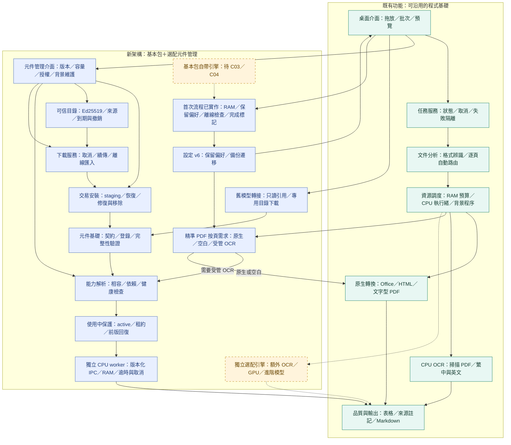

# 架構 v0.4：C10 逐頁能力與受管 OCR 協作

保存：2026-11-07（台北）。程式 0.8.0、架構 0.4；與首頁一併保存。藍色路由接上需求、版本／能力、整份文件租約與受管 CPU。C10 完成，已驗收 7/12，既有 19/25；C09 全項仍待基本包。

242 項含原版面 63 項及元件／裝置回歸，另有真正 frozen CPU／Qt 10 項。只有 OCR 頁要求元件，原生／空白頁不受缺元件阻擋，失效不自動下載或換引擎。Windows／GPU、正式來源、基本包／profile 與完整 C09 保留未完成門檻。

[C10 設計與驗收](../../managed-conversion.md) · [快照索引](../README.md)
