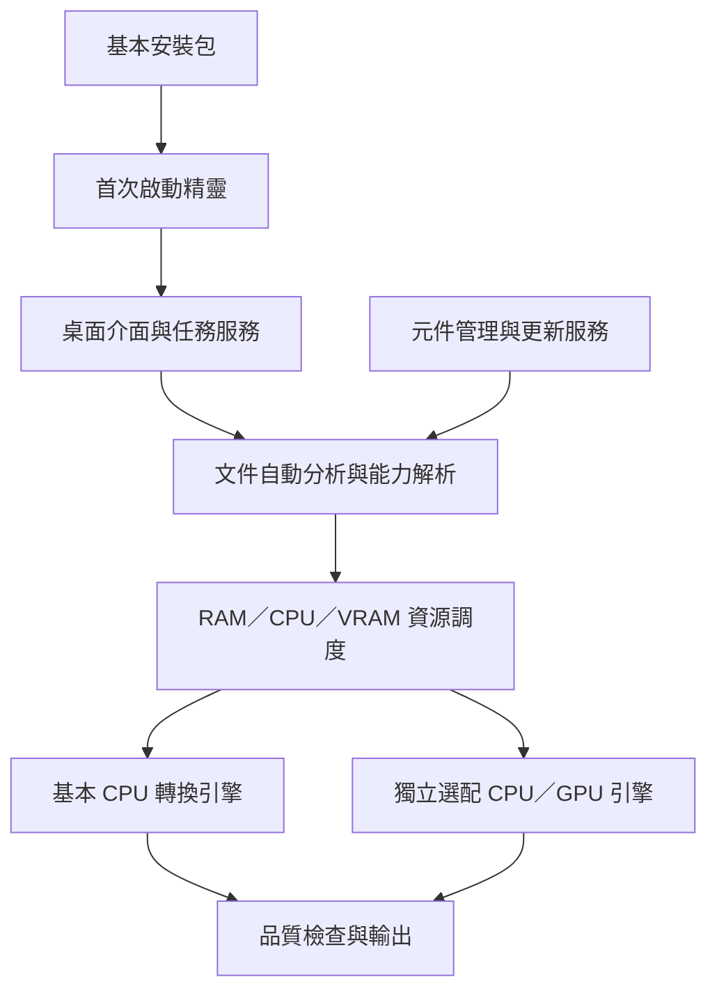

# 新版架構 v0.4：基本安裝包＋選配元件管理（指定對話原圖）

保存日期：2026-11-06（台北）。程式原始碼版本：0.1.1。

保存使用者指定的那張圖：前面對話「模組架構會保留既有核心，增加元件管理層。」下方的 Mermaid。以下保留該圖的節點與連線，不以較詳細的文件圖取代。

新增方向：基本安裝包、首次啟動精靈、能力解析、獨立選配 CPU／GPU 引擎及元件／更新服務。原桌面、任務、文件分析、資源管理、品質與輸出繼續沿用。

這是目標架構，不是全部功能已實作的狀態圖。新增 C01–C12 目前 0/12，既有基線 19/25；Windows 基本 OCR 整合與 GPU 實機仍待完成。

前版責任對照：[舊架構核心](v0.3-existing-core.md)；過渡狀態：[當時首頁比較圖](v0.4-homepage-comparison.md)。

[返回架構紀錄索引](../README.md) · [目前完整架構指引](../../architecture-guide.md)
