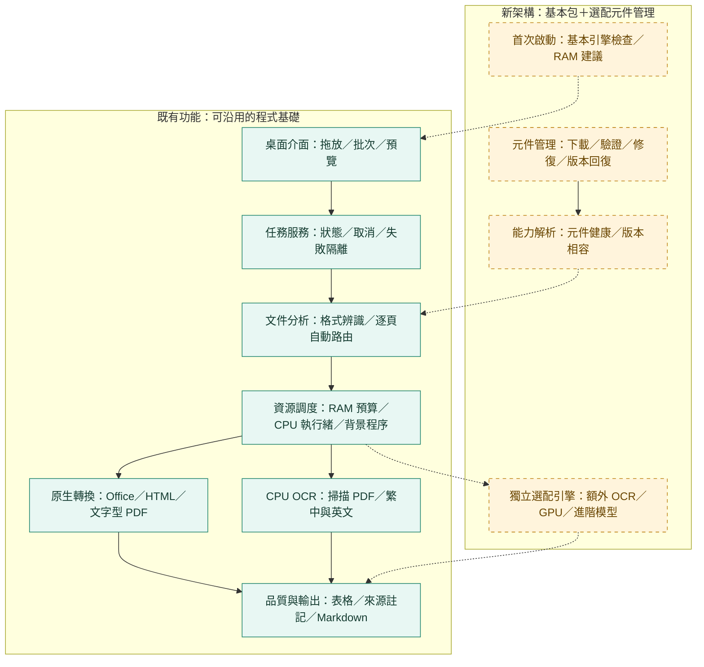

# 首頁比較圖 v0.4：既有核心與新增元件層

保存日期：2026-11-06（台北）。程式原始碼版本：0.1.1。

保存本次操作前 GitHub 首頁的完整比較圖。Mermaid 原文由固定提交直接抽出，包含既有／規劃分組、虛線與配色。

綠色實線區塊為可沿用的核心與桌面原型；黃色區塊為待導入的元件架構。比較圖的用途是呈現新增範圍；新版的完整主流程另見[指定對話圖](v0.4-conversation.md)。

來源：[README 固定提交 eaff817](https://github.com/ChouTa-chuan/MarkItDown-exe/blob/eaff81750d0c60f0798e2ce34c7b8c22b5dd913c/README.md)。本圖逐字保存，未變更首頁原圖。

[返回架構紀錄索引](../README.md) · [目前完整架構指引](../../architecture-guide.md)
