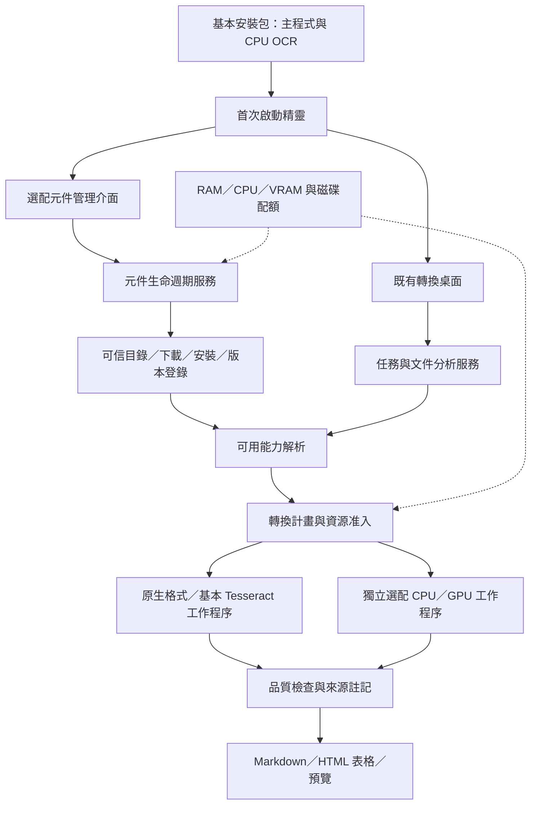

# 新版架構 v0.4：第四節完整模組架構圖與責任表

保存日期：2026-11-06（台北）。程式原始碼版本：0.1.1；架構指引版本：0.4。

本次補存使用者指出的「四、模組化架構」下方詳細圖，對應完整指引的「四、模組化架構與責任」。以下逐字保存該節的原圖、說明與模組責任表，與先前的對話主流程簡圖分開記錄。

來源：[固定提交 828b873 的完整架構指引](https://github.com/ChouTa-chuan/MarkItDown-exe/blob/828b87355a3a22bd4071a7831ed139256d3144c6/docs/architecture-guide.md)。

## 四、模組化架構與責任

依賴方向為 UI → 應用服務 → 核心契約／能力解析 → 引擎轉接器；視窗不直接下載、執行安裝指令或更換 runtime。文件分析決定需要什麼，能力解析決定有哪些，資源調度決定何時與以多大負載執行。

| 模組 | 責任與界線 | 既有基礎／處理方式 |
| --- | --- | --- |
| desktop／ui | 轉換、預覽與資源設定 | 沿用 desktop.py；只增加精靈及元件介面入口 |
| onboarding | 首次檢查、引擎就緒、初始設定與完成紀錄 | 新增；不常駐、不強制連網 |
| application | 任務、批次、狀態、取消與失敗隔離 | 沿用 Runner；增加元件版本固定與能力解析 |
| core | 任務、結果、錯誤、能力與元件契約 | 延伸 core.py，保留既有 Request 相容性 |
| planning／analysis | 格式、逐頁路由及必要處理判斷 | 沿用 planning.py、pdf_pipeline.py；支援能力不足的明確結果 |
| capabilities | 格式需求、元件健康與相容性解析 | 新增；讀取實測健康紀錄，不以已下載代替可用 |
| components | 安裝／修復／移除／版本與使用中鎖定的服務入口 | 新增；內部分開 catalog、registry、download、installer、locks |
| component_workers | 選配引擎的程序協定、逾時、取消與結果轉接 | 新增；各自打包 runtime，不把任意 Python 套件注入主程式 |
| converters | MarkItDown 與原生格式解析 | 沿用 conversion.py 及 vendor 轉接，不重寫所有格式 |
| inference／models | OCR、模型與裝置後端 | 既有 Tesseract／ONNX 分別做 adapter，模型管理逐步接入 components |
| resources | RAM／CPU／VRAM 准入、回壓、暫停／恢復 | 沿用 resources.py；加入下載、解壓、安裝及磁碟預算 |
| workers | 任務程序隔離、資源控制與清理 | 沿用 workers.py；增加與獨立元件 worker 的橋接 |
| quality／exporters | 差異、結構、來源註記與輸出保護 | 沿用既有品質、表格、輸出流程，不因拆包降低判準 |
| updates | 主程式／元件相容性、更新通知、回復 | 新增；主程式由安裝器更新，元件走受控生命週期 |
| settings／infrastructure | 設定、索引、日誌、檔案、快取 | 保留 schema v5，規劃 v6 遷移；不搬移未知檔案 |
| packaging／diagnostics | 發行 profile、原生元件、授權、安裝與自我檢查 | 沿用 Inno／PyInstaller／diagnostics，改成按 profile 驗收 |

新增是責任與介面的拆分，不等於每列都要重做一套框架。統一文件結構按需求逐步加入段落、標題、表格、圖片、公式與來源；現有 Markdown 相容結果繼續可用。選配元件先限定專案維護的固定功能，不建立第三方外掛商店。

## 本次補存的範圍

- 基本安裝包、首次啟動精靈、既有桌面及選配元件管理介面。
- 任務分析、元件生命週期、可信目錄／下載／安裝／版本登錄及可用能力解析。
- 轉換計畫、原生／基本 Tesseract 與獨立選配 CPU／GPU 工作程序。
- 品質、來源、輸出，以及 RAM／CPU／VRAM／磁碟配額對安裝和轉換的支援關係。
- 原第四節的完整模組責任表與既有程式沿用說明。

這是 v0.4 目標架構存檔。功能驗收狀態維持原紀錄，未因補圖改為已實作；先前三份快照保留原文與雜湊。

[架構紀錄索引](../README.md) · [先前對話主流程簡圖](v0.4-conversation.md) · [目前完整指引](../../architecture-guide.md)
