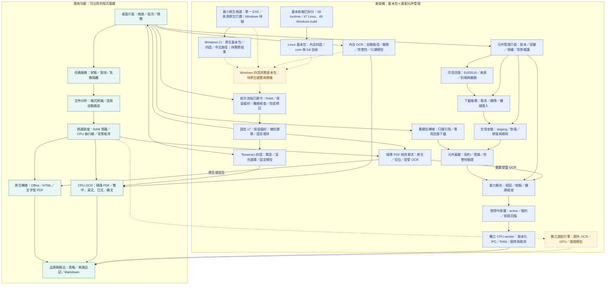

# 架構 v0.4：Windows 基本包 CI 準備

保存日期：**2026-11-08（台北）**。程式 **0.14.0**、架構 **0.4**；第十九份快照，前十八份固定。來源為本次首頁圖，與實作一併提交。

新增獨立 Windows CI，固定輸入／原生基本包建置／四語與中文路徑／故障／Qt 與實際報告；此圖保存準備階段，尚未以遠端結果關閉門檻。C03 3/4、C04 2/4、C09 3/4、完整 7/12、既有 19/25 保留，hosted runner 不是乾淨機。

詳見[Windows CI 指引](../../windows-base-ci.md)。不建立 Setup／Release、不觸發舊手動發行；只有真正執行結果才能另存通過。
